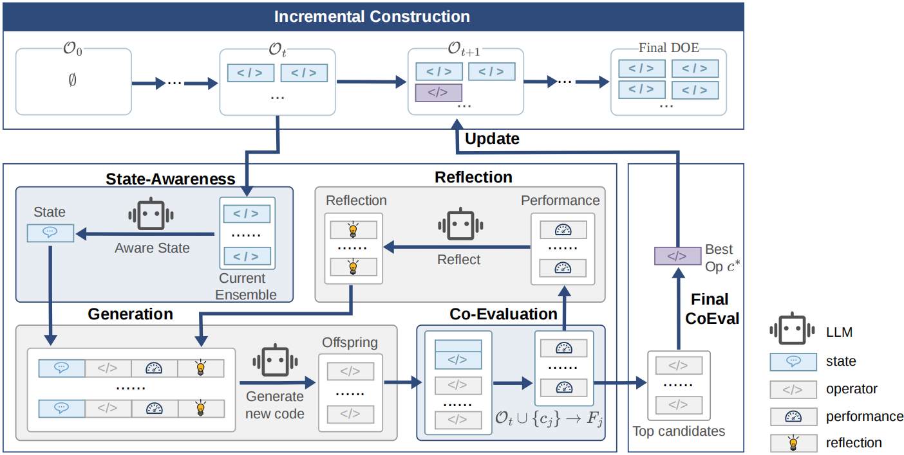

# SCOE: Stagewise Cooperative Operator Ensemble Evolution

This repository provides the implementation of **SCOE**, an LLM-driven framework for automatically designing destruction operator ensemble. SCOE is instantiated in an iterated greedy (IG) algorithm for the **Permutation Flow Shop Scheduling Problem (PFSP)**. The repository also includes a benchmark derived from real industrial production data.

**Paper:** [Large Language Model-Driven Cooperative Operator Ensemble Evolution for Permutation Flow Shop Scheduling](https://arxiv.org/abs/2606.15334)  
**Status:** Accepted by *IEEE Transactions on Evolutionary Computation* (TEVC); journal publication pending.

## Overview

SCOE incrementally constructs an operator ensemble: an LLM generates candidate destruction operators, which are evaluated by their contribution to the existing ensemble within the IG solver. The resulting operator ensemble is used in **IG-DOE** for PFSP.



## Repository Structure

```text
industrial_data/             Industrial PFSP benchmark (12 instances)
scoe/
  main.py                    Main entry point
  src/ig.py                  PFSP-IG solver and instance reader
  src/connect.py             Operator evaluation and coordination
  reevo-main/                ReEvo-based LLM generation module
```

The industrial benchmark contains 12 instances at six job–machine scales: `80x20`, `100x20`, `100x40`, `200x20`, `200x40`, and `300x20`. The instances are derived from production logs and processing requirements of an instrument-manufacturing workshop in Shanghai. Files follow the pattern `RealPFSP_<jobs>_<machines>_<index>.txt`; the first line specifies the numbers of jobs and machines.

## Getting Started

**Requirements:** Python 3.11 or later is recommended. From the repository root:

```bash
python -m venv .venv
source .venv/bin/activate  # Windows: .venv\Scripts\activate
pip install -e ./scoe/reevo-main
pip install pandas openpyxl
```

Configure your LLM API credentials and settings as appropriate for your provider. The relevant configuration files are:

- `scoe/reevo-main/cfg/config.yaml`
- `scoe/reevo-main/cfg/llm_client/openai.yaml`

Run the PFSP instantiation from the repository root:

```bash
python scoe/main.py
```

## Citation

If you use this code or benchmark, please cite our paper. The paper has been accepted by *IEEE Transactions on Evolutionary Computation*; the arXiv preprint is available at [arXiv:2606.15334](https://arxiv.org/abs/2606.15334).

```bibtex
@misc{xu2026largelanguage,
  title         = {Large Language Model-Driven Cooperative Operator Ensemble Evolution for Permutation Flow Shop Scheduling},
  author        = {Rui Xu and Yufan Liao and Haoze Lv and Shengcai Liu and Yi Mei and Ke Tang},
  year          = {2026},
  eprint        = {2606.15334},
  archivePrefix = {arXiv},
  primaryClass  = {cs.NE},
  url           = {https://arxiv.org/abs/2606.15334}
}
```

The citation will be updated when the IEEE journal version becomes available.

## Acknowledgments and License

The LLM generation module builds on [ReEvo](https://ai4co.github.io/reevo/), included under `scoe/reevo-main/`. Please retain its original MIT license and copyright notices when redistributing it. For the rest of this repository, see the top-level `LICENSE`.
